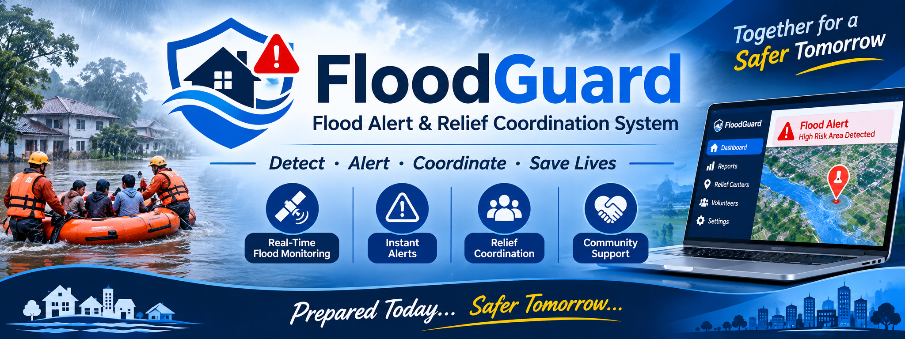

<p align="center">
  
</p>
# FloodGuard – Flood Alert & Relief Coordination System

A MERN-stack web application designed to support flood emergency reporting, alert management, and coordination between administrators, citizens, and volunteers.

## Overview

FloodGuard provides a shared platform where citizens can report flood-related incidents, administrators can review reports and manage alerts, and volunteers can receive and update assigned relief tasks.

The project aims to demonstrate how web technologies can support communication and coordination during flood emergencies.

## Key Features

- **Role-based access:** Separate experiences for administrators, citizens, and volunteers.
- **Citizen reporting:** Submit flood-related reports with image uploads.
- **Alert management:** Administrators can create and update flood alerts.
- **Volunteer coordination:** Administrators can manage volunteer tasks and track their status.
- **Relief-centre management:** Manage relief-centre information.
- **Interactive map:** Display locations using Leaflet and OpenStreetMap.
- **Notifications:** Browser notifications and an alert sound when supported and permitted by the browser.
- **Authentication:** Password hashing and JWT-based authentication.

## User Roles

| Role | Responsibilities |
|---|---|
| Administrator | Review reports, manage alerts, coordinate volunteers and relief centres, and manage tasks |
| Citizen | Submit flood reports and view relevant alerts |
| Volunteer | View assigned tasks and update task status with completion evidence |

## Technology Stack

| Area | Technologies |
|---|---|
| Frontend | React, Vite, React Router |
| Backend | Node.js, Express |
| Database | MongoDB, Mongoose |
| Authentication | JSON Web Tokens (JWT), bcryptjs |
| Image uploads | Multer |
| Maps | Leaflet, React Leaflet, OpenStreetMap |
| Icons | Lucide React |
| Notifications | Browser Notification API, Service Worker |

## Application Architecture

```text
                 FLOODGUARD
                     |
          +----------+----------+
          |                     |
       Frontend              Backend
       React + Vite          Node + Express
          |                     |
          |                REST API
          |                     |
          +---------------------+
                                |
                            MongoDB
```

## Project Workflow

1. A user signs in with the appropriate role.
2. Citizens submit flood-related reports.
3. Administrators review reports and publish alerts.
4. Administrators coordinate volunteers and relief tasks.
5. Volunteers view assigned tasks and update their progress.
6. Users can access relevant information through their role-based dashboards.

## Project Structure

```text
FloodGuard/
│
├── client/
│   ├── public/
│   ├── src/
│   ├── .env.example
│   ├── package.json
│   └── package-lock.json
│
├── server/
│   ├── middleware/
│   ├── models/
│   ├── routes/
│   ├── uploads/
│   ├── .env.example
│   ├── createAdmin.js
│   ├── server.js
│   ├── package.json
│   └── package-lock.json
│
├── .gitignore
└── README.md
```

## Prerequisites

Install the following before running the application:

- Node.js and npm
- MongoDB local installation or MongoDB Atlas account
- Git

## Installation and Setup

### 1. Clone the repository

```bash
git clone https://github.com/YOUR-USERNAME/floodguard-flood-relief-coordination.git
cd floodguard-flood-relief-coordination
```

### 2. Configure the backend

```bash
cd server
npm install
```

Create your local `.env` file using `.env.example` as a reference.

Configure the required values:

```env
PORT=5000
MONGO_URI=your_mongodb_connection_string
JWT_SECRET=your_long_random_secret
ADMIN_NAME=FloodGuard Admin
ADMIN_EMAIL=your_admin_email
ADMIN_PASSWORD=your_strong_admin_password
```

Create the administrator account if one does not already exist:

```bash
node createAdmin.js
```

Start the backend:

```bash
node server.js
```

### 3. Configure the frontend

Open another terminal:

```bash
cd client
npm install
```

Create a local `.env` file using the frontend `.env.example`:

```env
VITE_API_URL=http://localhost:5000/api
```

Start the frontend:

```bash
npm run dev
```

Open the local URL displayed by Vite in your browser.

## Environment Variables

Never commit your actual `.env` files or private credentials.

The repository includes `.env.example` files as configuration templates. Replace the example values with your own local settings.

## Current Project Scope

FloodGuard is an academic project prototype demonstrating flood reporting and relief coordination workflows.

It does not currently provide independently verified flood prediction, official government warning integration, or guaranteed emergency response. Browser notifications also depend on browser permissions and platform support.

## Future Enhancements

- Integration with official weather and disaster-management data sources.
- AI-assisted flood risk analysis using reliable data.
- Real-time alert delivery.
- Improved report privacy and role-based API authorization.
- Secure cloud-based image storage.
- Deployment with production-grade security and monitoring.

## Project Objective

To develop a role-based web application that demonstrates how citizens, administrators, and volunteers can coordinate flood-related reporting and relief activities through a common platform.

---

**FloodGuard – Connecting people, alerts, and relief coordination.**