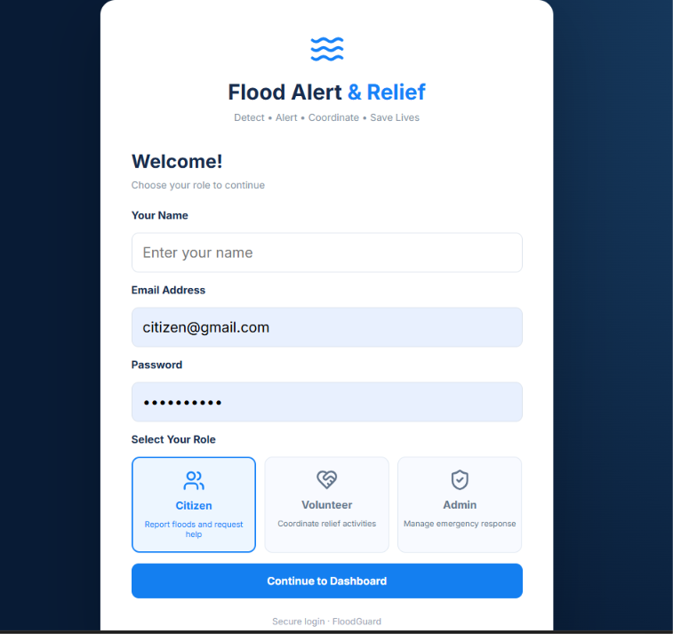
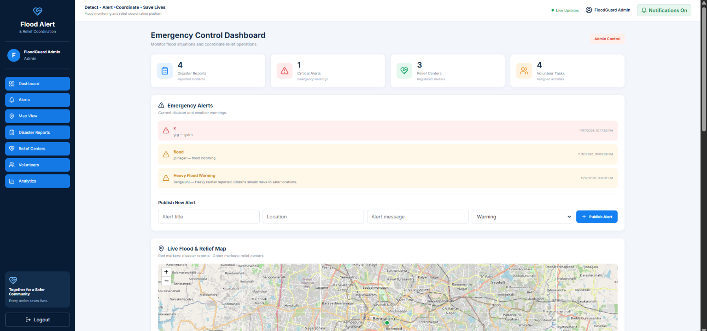
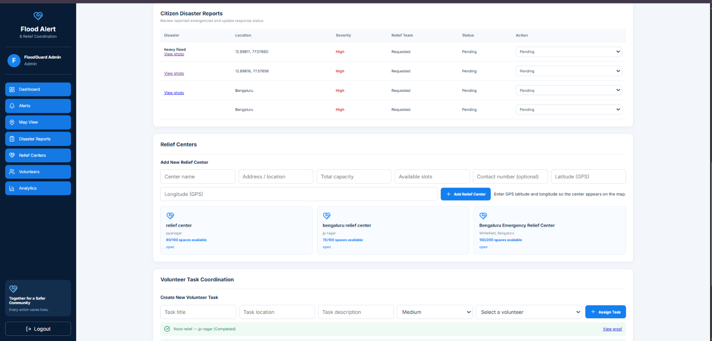
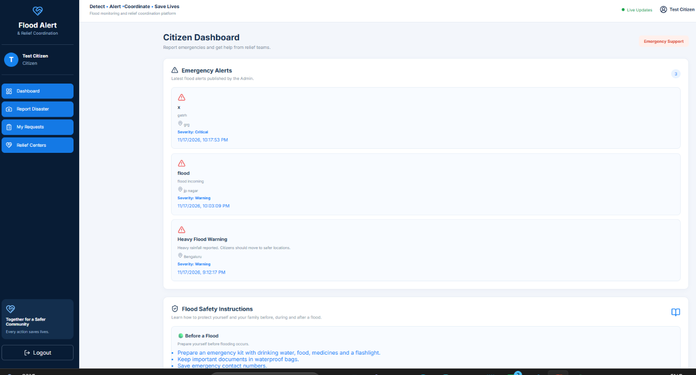
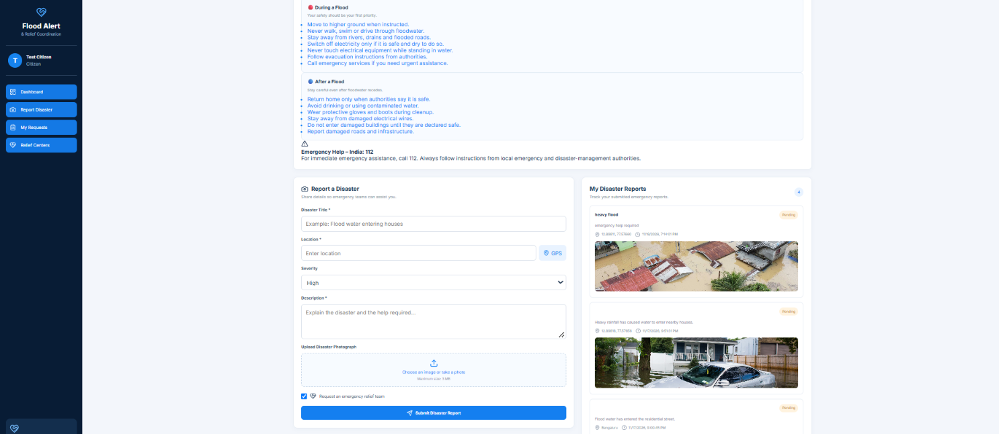
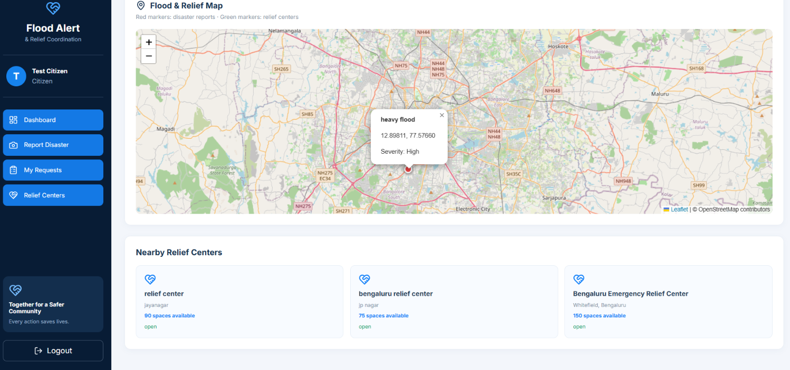
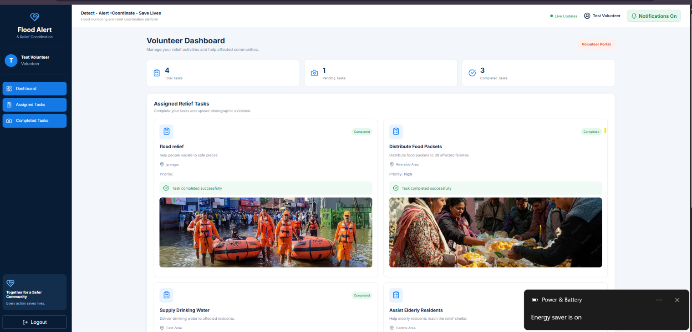
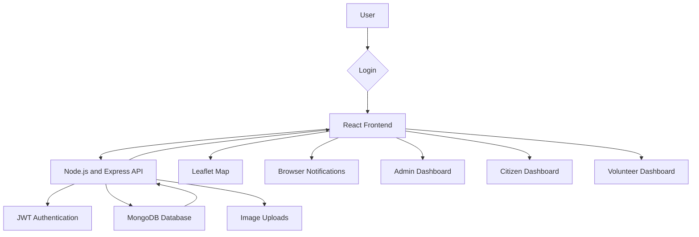

# 🌊 FloodGuard
### Flood Alert & Relief Coordination System

A web-based platform for flood emergency reporting, alert management and relief coordination.
---

## 📌 1. Project Overview

FloodGuard is a MERN-stack web application developed to improve flood emergency communication and relief coordination.

During floods, people may face difficulties reporting emergencies, receiving important updates and connecting with relief volunteers.

FloodGuard provides a centralized platform where:

- Citizens can report flood-related emergencies.
- Administrators can review reports and publish flood alerts.
- Volunteers can view assigned relief tasks and submit completion proof.
- Users can access map-based location information.

The main objective is to improve communication, emergency awareness and coordination during flood situations.

## 🎯 2. Objectives

- Provide a centralized flood emergency reporting platform.
- Enable administrators to manage emergency alerts.
- Support coordination between citizens and volunteers.
- Provide map-based visualization of relevant locations.
- Improve the organization of relief activities.
- Build a foundation for future intelligent disaster-management features.

## 👥 3. User Roles and Responsibilities

### 🛡️ Administrator

- Manage the flood alert system.
- View and review citizen emergency reports.
- Create and manage flood alerts.
- Coordinate volunteer activities.
- Manage relief-related information.

### 👤 Citizen

- Access the citizen dashboard.
- Submit flood emergency reports.
- Upload supporting images.
- View relevant flood alerts and report information.

### 🤝 Volunteer

- Access assigned relief tasks.
- View task-related information.
- Perform assigned relief activities.
- Upload images as proof of task completion.

## ✨ 4. Key Features

| Feature               | Description                                      |
| --------------------- | ------------------------------------------------ |
| Role-based Login      | Separate access for Admin, Citizen and Volunteer |
| Emergency Reporting   | Citizens can submit flood-related reports        |
| Image Upload          | Upload images with emergency reports             |
| Flood Alerts          | Administrators can publish important alerts      |
| Volunteer Management  | Coordinate relief tasks and activities           |
| Task Completion Proof | Volunteers can upload completion images          |
| Interactive Map       | Display relevant locations using Leaflet         |
| Browser Notifications | Support browser-based alerts and notifications   |
| Dashboard             | Role-specific information and activities         |

## 📸 Application Screenshots

### Login Page


### Administrator Dashboard




### Citizen Dashboard






### Volunteer Dashboard



## 🛠️ 6. Technologies Used

### Frontend

- React.js – Building interactive user interfaces.
- Vite – Frontend development and build tool.
- React Router – Navigation between application pages.
- CSS – Styling and responsive layouts.
- Axios – API communication.
- Leaflet and React Leaflet – Interactive maps.
- Lucide React – Icons.

### Backend

- Node.js – JavaScript runtime.
- Express.js – Backend API framework.
- MongoDB – Database.
- Mongoose – MongoDB object modeling.
- JWT – Authentication.
- bcryptjs – Password hashing.
- Multer – Image upload handling.

### Other Technologies

- Git and GitHub – Version control and project hosting.
- OpenStreetMap – Map data.
- Browser Notification API and Service Workers – Browser notifications.

## 🏗️ 7. System Architecture

FloodGuard follows a client-server architecture.



## 🔄 8. Project Workflow

1. The user opens the FloodGuard application.
2. The user logs in through the authentication system.
3. The application provides access based on the user's role.
4. Citizens submit emergency reports with relevant information and images.
5. Administrators review reports and create flood alerts.
6. Volunteers access their assigned relief tasks.
7. Volunteers carry out tasks and upload completion proof.
8. Relevant information is managed through the backend and database.

## 📂 9. Project Structure

```text
FloodGuard/
│
├── client/
│   ├── public/
│   ├── src/
│   ├── .env.example
│   ├── package.json
│   └── package-lock.json
│
├── server/
│   ├── middleware/
│   ├── models/
│   ├── routes/
│   ├── uploads/
│   ├── .env.example
│   ├── createAdmin.js
│   ├── server.js
│   ├── package.json
│   └── package-lock.json
│
├── screenshots/
│   ├── floodguard-banner.png
│   ├── login.png
│   ├── admin1.png
│   ├── admin2.png
│   ├── citizen1.png
│   ├── citizen2.png
│   ├── citizen3.png
│   └── volunteer.png
│
├── .gitignore
└── README.md
```

## ⚙️ 10. Installation and Setup

### Prerequisites

Install the following:

- Node.js and npm
- MongoDB
- Git
- Visual Studio Code (recommended)

### Step 1: Clone the repository

```bash
git clone https://github.com/varshakp60-svg/floodguard-flood-relief-coordination.git
```

### Step 2: Open the project

```bash
cd floodguard-flood-relief-coordination
```

### Step 3: Configure the backend

```bash
cd server
npm install
```

Create a `.env` file inside the server folder using `.env.example` as a reference.

Configure:

```env
PORT=5000
MONGO_URI=mongodb://127.0.0.1:27017/floodguard
JWT_SECRET=your_long_random_secret

ADMIN_NAME=FloodGuard Admin
ADMIN_EMAIL=admin@example.com
ADMIN_PASSWORD=your_strong_password
```

Use your own secure credentials and secret values.

### Step 4: Start the backend

```bash
node server.js
```

### Step 5: Configure the frontend

Open another terminal:

```bash
cd client
npm install
```

Create a `.env` file in the client folder:

```env
VITE_API_URL=http://localhost:5000/api
```

### Step 6: Start the frontend

```bash
npm run dev
```

Open the local URL displayed by Vite in your browser.

**Note:** Ensure MongoDB is running and the backend environment variables are configured correctly. Create an administrator account using the project's admin setup script if one has not already been created. Do not run the account creation script repeatedly without checking for an existing administrator.

## 🔐 11. Environment and Security

- Environment files containing credentials are excluded from Git.
- Example environment files are provided for configuration.
- Passwords are hashed using bcryptjs.
- JWT is used for authentication.
- Uploaded images are excluded from the repository.
- Production deployment requires additional authorization and security configuration.

## 📍 12. Current Project Scope and Limitations

FloodGuard is an academic prototype demonstrating flood emergency reporting and relief coordination.

Current limitations include:

- It does not independently predict future floods using an AI model.
- It does not directly integrate with official government flood-warning systems.
- Browser notifications depend on browser support and user permissions.
- It requires further security, scalability and reliability improvements before real-world deployment.

## 🚀 13. Future Enhancements

The following features can be considered for future development:

1. AI-based flood risk prediction using weather and historical flood data.
2. Integration with trusted government weather and disaster-warning APIs.
3. Real-time flood monitoring and alert generation.
4. SMS and mobile push notifications.
5. Advanced GIS-based flood-risk visualization.
6. Live volunteer location tracking.
7. Improved emergency resource and relief-centre management.
8. Stronger authentication, authorization and data protection.

## 🎓 14. Project Objective

FloodGuard aims to demonstrate how web technologies can support disaster response through centralized emergency reporting, alert management and volunteer coordination.

The project provides a foundation for developing more advanced and intelligent disaster-management solutions.

## 👩‍💻 15. Developed As

**Project Name:** FloodGuard – Flood Alert & Relief Coordination System

**Project Type:** Academic Mini Project

**Architecture:** MERN Stack

**Repository:** [GitHub – FloodGuard](https://github.com/varshakp60-svg/floodguard-flood-relief-coordination)

---

\<p align="center">
&#x20; \<b>🌊 FloodGuard – Prepared Today, Safer Tomorrow.\</b>
\</p>
